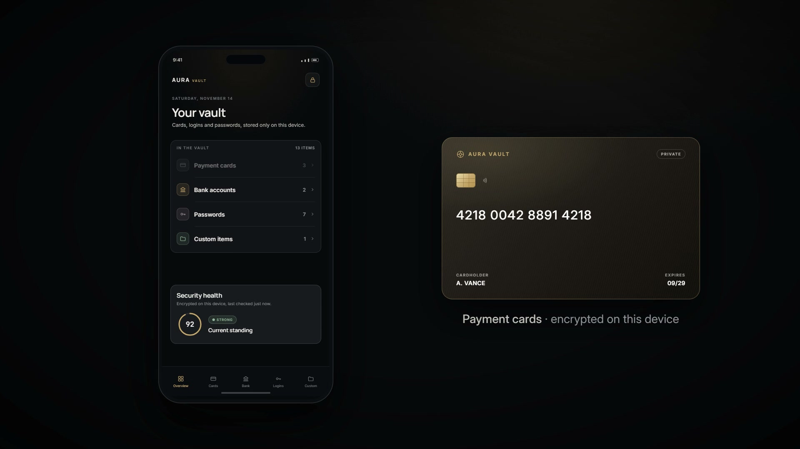
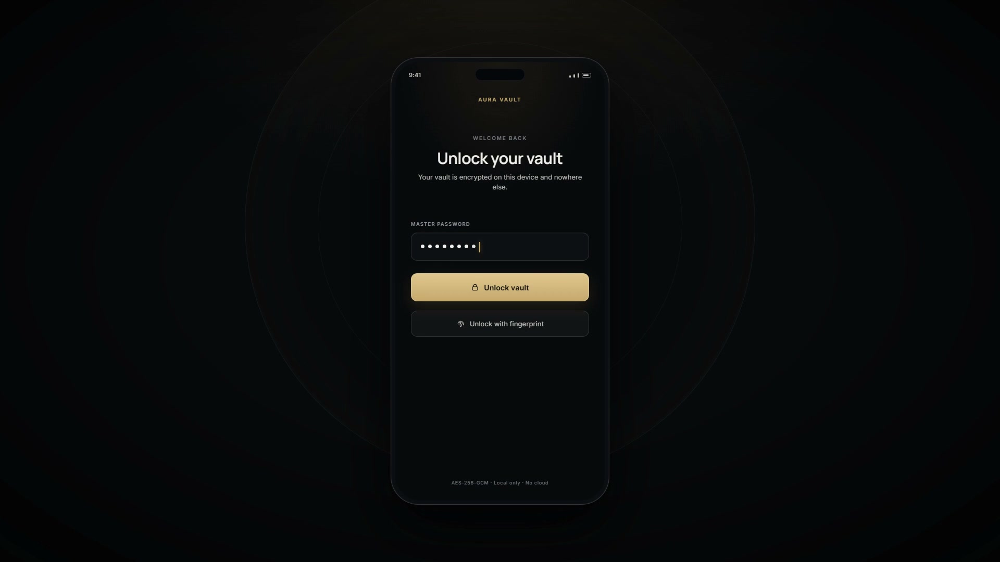
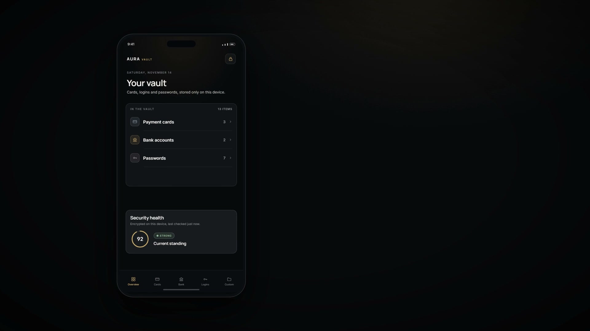
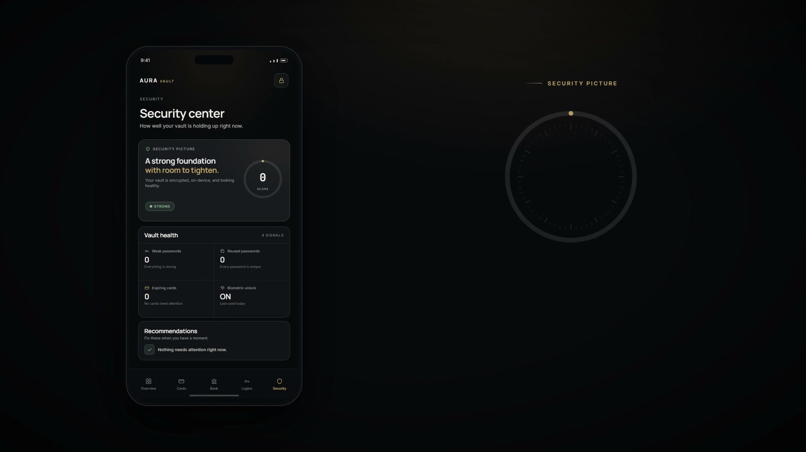

# Aura Vault

**A private, offline vault for your cards, logins, and passwords.**

Native Android · Kotlin · No network permission · AES-256-GCM on device



Aura Vault keeps sensitive personal data in a single encrypted file on the phone. There is no account, no sync, and no `INTERNET` permission in the manifest — the app has no network path, so your data cannot leave the device.

Most password managers are cloud services with an offline mode. This is the opposite: a local vault that never had a network path to begin with.

## Features

- **Cards** — premium card visuals, on-device OCR scanning, masked numbers, controlled CVV reveal
- **Everything else** — bank accounts, logins and passwords, and custom items in one searchable vault
- **Encrypted at rest** — the vault payload is sealed with AES-256-GCM
- **Two ways back in** — master password (12+ characters) plus a one-time recovery key
- **Biometric unlock** — optional, backed by an Android Keystore key that requires strong authentication
- **Encrypted backup** — export and import the vault as a sealed archive
- **Security centre** — a live score across weak passwords, reused passwords, expiring cards, and biometric state
- **Screen capture blocked** — `FLAG_SECURE` on sensitive windows
- **Sensitive clipboard** — copied values are tagged, and cleared after 30 seconds
- **Backup disabled** — `android:allowBackup="false"`, so ADB cannot extract app data

## Screenshots

| Unlock | Vault | Security centre |
|:---:|:---:|:---:|
|  |  |  |

## Demo

A 21-second product film lives at [`docs/demo.mp4`](docs/demo.mp4). It is a motion recreation of the app's iron-and-brass vault room, not a screen recording.

## Security model

- The vault payload is encrypted with AES-256-GCM.
- A random data key is wrapped by a PBKDF2-HMAC-SHA256 master-password key and by a random recovery key.
- Optional fingerprint unlock wraps the data key with an Android Keystore key that requires strong biometric authentication.
- No `android.permission.INTERNET` is declared. There is no backend, analytics SDK, or remote configuration.
- The manifest sets `allowBackup="false"`; sensitive activities set `FLAG_SECURE`.
- Clipboard entries are marked `EXTRA_IS_SENSITIVE` and wiped after 30 seconds if unchanged.

## Build

Requirements: Android Studio with Android SDK 36, JDK 17+, and an Android 11 (API 30) or newer device or emulator.

```powershell
.\gradlew.bat assembleDebug
.\gradlew.bat testDebugUnitTest
```

The debug APK is written to `app/build/outputs/apk/debug/app-debug.apk`.

Open the project folder in Android Studio and allow Gradle sync. To run it, enable Developer options and USB debugging on the device, connect it, then press Run.

## Project structure

```text
app/src/main/java/com/example/cardvault/
  MainActivity.kt      screens, navigation, flows
  VaultStore.kt        encryption, persistence, backup
  SecurityAudit.kt     security scoring
  VaultComponents.kt   dials, rows, vault door
  CardVisuals.kt       card rendering and OCR capture
  VaultTheme.kt        tokens, type, shapes, motion
  SessionKeeper.kt     auto-lock and session lifecycle
  VaultRuntime.kt      runtime wiring
```

## Status

This is an early prototype. It has **not** been independently security-reviewed and has not been exercised on a wide range of physical devices. Keep using dummy information until those checks are complete.

Losing both the master password and the recovery key means losing access to the vault. Changing or removing enrolled fingerprints can disable biometric unlock; the password and recovery key remain the recovery path.

## License

MIT — see [LICENSE](LICENSE).
